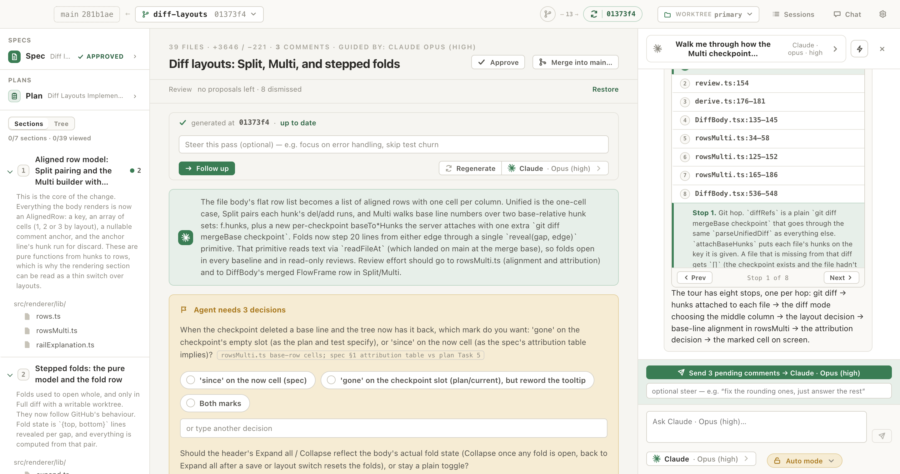
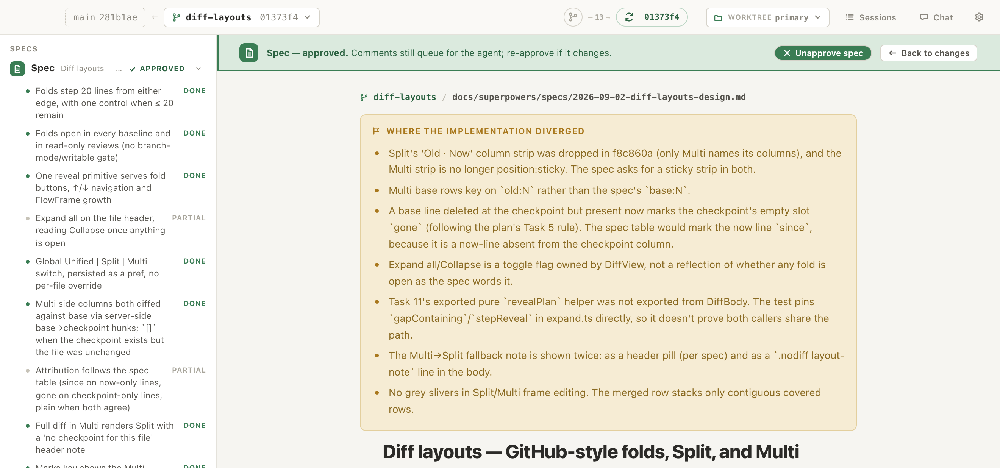
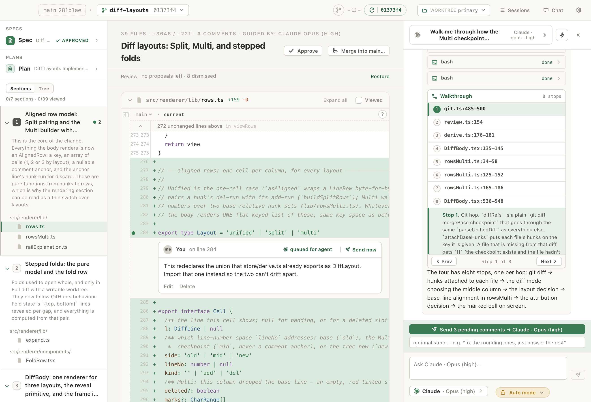
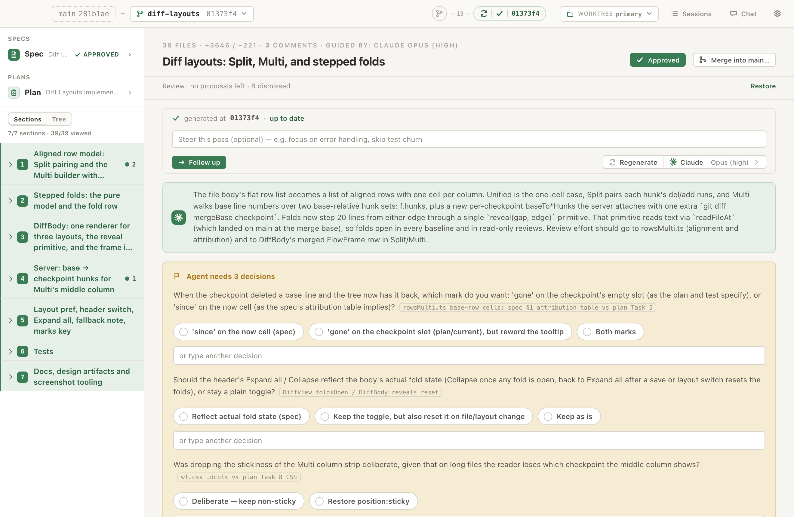

# Limn

[](https://github.com/glebmish/limn/actions/workflows/ci.yml)
[](https://github.com/glebmish/limn/releases/latest)
[](LICENSE)

**Review what your coding agent wrote before you push or merge.** Limn opens a local git branch in your browser, has Claude or Codex explain the change section by section, and lets you comment on any line and send the comments back to the agent to fix.

**Quick start:** `npm i -g https://github.com/glebmish/limn/releases/latest/download/limn.tgz`, then run `limn` inside a git repo. Needs Node 22.13+ and the `claude` or `codex` CLI — see [Prerequisites](#prerequisites).


- **Guided review** — Agent explains what has changed, splits the diff into logical sections and asks clarifying questions.
- **Agentic tools** — Tools that let the agent navigate for you: jump to the file that builds a database query, walk the auth flow across files.
- **Spec/plan cross-check** — flags where the implementation diverged from what the spec and plan define.
- **Comment on anything** — diff lines, spec lines, plan steps, section narration — comment and agent will follow up on it.
- **Agent agnostic** — Works with Claude or Codex, driving your own `claude` / `codex` CLI through bundled Agent Client Protocol adapters.
- **Native support for quick local iterations** — see diff from the last reviewed state, update narration for the new commits.


## What it does

**Narrates the change.** The agent explores callers, tests, and history, then explains how the change actually works — here, an eight-stop tour that follows one diff column from the server's `git diff` through row alignment to the cell on screen, scrolling the diff to each stop.



**Checks the change against the spec.** Limn auto-discovers specs and plans based on popular conventions and flags where the implementation diverged, criteria by criteria.



**Follows up on comments.** Leave comments on any line, section, or spec point, send them to the agent — it will read callers, run commands, edit files — then report a resolution per comment and commit the changes.



**Shows updates as they come.** When new commits land — from the agent or the user — a header pill shows the drift; after reload, diff shows just the delta. Agent can also update the narration based on the new changes.



## Security & privacy

Limn is a local app with no telemetry, accounts, hosted backend, or cloud sync of
its own. It does not store Claude, Codex, Anthropic, or OpenAI credentials. It uses
the credentials and command-line agents already installed and authorized on your
machine (`claude`, `codex`). Limn also does not use macOS Keychain. The service binds
`127.0.0.1` only; any other bind requires `LIMN_WEB_TOKEN` and refuses to start without
it.

**The trust model on loopback is the machine itself.** With the default bind there is
no token, so any process running as any user on that machine can reach the port and
drive Limn — read your repos, run the agent — exactly as you can. What the perimeter
does stop is the *browser*: `/rpc/*` and `/events` refuse a cross-site or opaque
`Origin`, refuse a `Host` that is not loopback, and require a JSON content type, so a
web page you visit cannot reach the service.

Review state lives in one local SQLite database at a per-user location
(`~/Library/Application Support/limn/limn.db` on macOS). That database stores the
review layer: repositories you opened, sessions, comments, chat, generated review
notes, viewed flags, and approvals. Git remains the source of truth for code:
diffs, file contents, and branch state are read from your working tree.

When you choose Claude or Codex, the selected provider receives the prompts and
repository context needed for the review, using your existing provider account or
API key. Limn itself does not send data anywhere else.

Limn runs a coding agent against your repo. The execution tier, set per agent,
controls how much it can do on its own:

- **Ask for approval** — the agent asks before anything it can't do read-only. Claude
  asks before commands and edits; Codex runs commands in a read-only sandbox with
  network off and asks before each edit.
- **Accept edits** — edits apply without asking. Claude still asks before commands that
  aren't read-only; Codex runs commands inside its workspace sandbox (network off)
  without asking, and asks before anything outside the workspace or any network access.
- **Auto mode** — the agent runs on its own; the provider's own safety checks (Claude's
  auto mode, Codex's auto-reviewer), not Limn's, decide what to stop or ask about.
- **Full access** — no sandbox and no confirmations: shell commands, network, edits and
  commits run without asking.

Only use **Auto mode** or **Full access** on repos you trust. New chats start in
**Auto mode**. For code you have not vetted, switch the chat to **Ask for approval**
or **Accept edits** using the tier selector under the composer.

Limn treats the branch under review as untrusted input. Claude sessions load only your
own `~/.claude` settings, skills and `CLAUDE.md`, never the repository's `.claude/`
settings or hooks, skills, commands, `.mcp.json` or `CLAUDE.md`. Review generation
denies every command or edit the engine asks permission for, and on Codex it runs in a
read-only sandbox. Remote images in agent-written markdown render as text. Details:
[What the agent reads from the repository](docs/using-limn.md#what-the-agent-reads-from-the-repository).

## Prerequisites

- Node 22.13+ (or 23.4+) and `git` on your PATH.
- At least one agent CLI, installed and signed in. Limn drives your own CLI and bundles
  neither; an API key without the CLI is not enough.
  - **Claude**: [Claude Code](https://code.claude.com) with `claude` on your PATH, logged
    in (run `claude` once) or with `ANTHROPIC_API_KEY` set.
  - **Codex**: the Codex CLI 0.160.1 or newer with `codex` on your PATH, logged in with
    `codex login` or with `OPENAI_API_KEY` set.

Either engine alone is enough; the agent picker shows which ones are ready. If a CLI is
not on the PATH Limn sees, set its absolute path in **Settings**. The background service
does not see variables exported in your shell, so with the service, log the CLI in
rather than relying on an API key. Usage is billed to the account the CLI uses.

## Install

```bash
npm i -g https://github.com/glebmish/limn/releases/latest/download/limn.tgz
limn
```

Limn is not on the npm registry: each release is a tarball attached to its
[GitHub Release](https://github.com/glebmish/limn/releases), and npm installs it
straight from that URL. The installed package is still named `@glebmish/limn`.

The first `limn` offers to install Limn as a background service (a LaunchAgent on
macOS, a `systemd --user` unit on Linux) so **http://limn.localhost:5466** is always
there; say `n` (or pass `--no-service`) to just run it in the foreground. To try it
without a global install:

```bash
npx https://github.com/glebmish/limn/releases/latest/download/limn.tgz
```

Answer `n` to skip the service; `y` installs that version globally from its release
first, then the service.

`*.localhost` resolves to your machine in Chrome,
Edge, Arc and Firefox with no setup; Safari does not resolve it — use
`http://127.0.0.1:5466` there.

Pin this release:

```bash
npm i -g https://github.com/glebmish/limn/releases/download/v0.4.0/glebmish-limn-0.4.0.tgz
```

To upgrade, run
`npm i -g https://github.com/glebmish/limn/releases/latest/download/limn.tgz` again,
then restart the service with the command
`limn service status` prints (`launchctl kickstart -k gui/$UID/dev.glebmish.limn` on
macOS, `systemctl --user restart limn` on Linux). What changed: [CHANGELOG.md](CHANGELOG.md).

Uninstalling — **remove the service first**, then the package:

```bash
limn service uninstall     # unload + delete the unit (the database is untouched)
npm uninstall -g @glebmish/limn
```

The other order leaves a `KeepAlive` / `Restart=always` unit pointing at files that no
longer exist, so launchd or systemd respawns it in a crash loop until you unload it by
hand.

If it doesn't start:

- `limn: command not found` — npm's global bin directory isn't on your PATH. `npm prefix -g`
  prints the prefix; add its `bin` directory to PATH.
- `Limn needs Node >= 22.13 (found …)` — upgrade Node to 22.13+ (or 23.4+).
- The agent picker says `claude` or `codex` was not found on PATH — install that CLI, or
  set its absolute path in Settings. The service records your login shell's PATH when it
  is installed, so after installing a CLI into a new directory, re-run
  `limn service install`.

## Using it

1. **Open a repository** (*Open repository…*) by typing its path — Limn adds it to the
   **Dashboard**'s repository index and remembers it across launches.
2. On the Dashboard: type to filter the list, ↑/↓ to move, ⏎ (or click) to open a
   repo's sessions. Each row shows its current branch (click the branch chip to open
   that branch's review) and when it was last active.
3. **Opening a repo lands directly on the review** for its current branch — the diff
   against the default base (`main` → `master` → first branch), already loaded. No
   session is minted until you act (comment, mark something viewed, generate, or
   approve); until then the header reads **Draft**.
4. Change the **base** with the ref picker (branches, recent commits, or a typed
   SHA / `HEAD~N` / tag); switch the **branch** — and where it's checked out — with the
   branch/worktree picker. Pick an engine — and optionally a model and reasoning effort
   (*Auto* uses the engine default) — then **Generate guided review**.
5. **Review**: mark files viewed, mark sections reviewed, comment on any diff line,
   section, agent question, or spec/plan line; **Chat** shares the agent's session.
   The **Sessions** button opens the repo hub with every saved review for the repo.
6. **Send N pending comments** (chat drawer) — the agent edits, commits on your branch
   when it's checked out, and reports a resolution per comment. **Approve** records the reviewed SHA.

Limn **watches the branch** — when commits land from outside (e.g. a Claude Code session in a terminal), a header fetch pill shows the drift and lets you reload when ready. After reload, "changed since viewed" / "changed since the review's baseline" rails highlight what moved. Diffs are syntax-highlighted with word-level change marks. Each file can be read three ways from the controls at its left edge: unified against any earlier checkpoint, side by side, or in three columns (base, a checkpoint, and now) that show what the review already covered and what changed after it. The ✓ there applies one file's choice to every file in the review. Unchanged lines fold and open 20 at a time, in any view.

### The address bar

Every screen has a URL, and the address bar always names the one you're on:

| URL | Screen |
| --- | --- |
| `/` | Dashboard |
| `/review/<id>` | A saved review |
| `/hub?repo=<path>` | A repo's saved-review list |
| `/review?repo=<path>&base=<ref>&compare=<ref>` | A draft review, before a session exists |

`/review/<id>` is durable — copy it, bookmark it, paste it into a chat, and it opens
that review again. Back and forward move between screens the way they do on any site.
A link to a review that no longer exists lands on the Dashboard with an error rather
than a blank page.

The hub and draft-review URLs carry the repository's path on your machine; Limn is a
local tool, so those links only mean anything on the machine that has the repo.

### The `limn` command

The CLI ships with the package. If the service is running it opens there; otherwise it
starts a server for you. `limn open [DIR] …` is the same command spelled out.

```bash
limn                                 # review the current branch of the repo you're in
limn ~/code/myrepo                   # same, for another repo (any path inside it works)
limn --base main --branch feature/x  # review a specific pair
limn --new                           # start a fresh review instead of resuming
limn --hub                           # open the repo's saved-review list
limn --generate                      # open the review and start generation immediately
limn --generate --print-url          # print the review URL instead of opening a browser
```

| Flag | Meaning |
| --- | --- |
| `DIR` (positional) | A path inside the repo to review — defaults to the current directory. |
| `--base REF` | The base ref (branch, tag, SHA) — defaults to the repo's default base. |
| `--branch BRANCH` | The branch to review — defaults to the current branch. |
| `--new` | Force a fresh review rather than resuming the latest one for the pair. |
| `--hub` | Open the repo hub (every saved review) instead of a review. |
| `--no-service` | Skip the service prompt; run in the foreground. |
| `--generate` | Start generation immediately: a fresh review with no session, an update pass on an existing one, or (with `--new`) a full pass on a brand-new session. |
| `--agent NAME` | Override the review agent (`claude` or `codex`) for this generation only. Needs `--generate`. |
| `--model NAME` | Override the model for this generation only. Needs `--generate`. |
| `--effort LEVEL` | Override the reasoning effort for this generation only. Needs `--generate` and a model. |
| `--print-url` | Print the page URL on stdout instead of opening a browser. |

```bash
limn service serve [--port N] [--port-80]   # foreground server (default 5466)
limn service install [--port-80]  # always-on background service (+ optional http://limn.localhost alias on :80)
limn service status               # activation (service / foreground / not running), URL, pid, node path, native stop/restart commands
limn service uninstall            # remove the service; database untouched
limn service logs [-f]
```

Bare `limn` behaves exactly like opening the repo from the Dashboard: a repo with
saved reviews lands on its session list, and one with none shows a draft review of
the current branch. Either way it opens in a new browser tab.

```bash
limn config                                # show the default review agent: engine, model, effort
limn config get agent|model|effort         # print one value
limn config set agent|model|effort <value> # change the default (validated; "auto" clears model/effort)
```

`limn config` talks to the running service when one is up, else reads/writes its
database file directly. Every new review starts from this default; changing the
agent inside a review changes that review only.

More in-flow details — excluding untracked files, multiple reviews per branch,
dirty-worktree review, the default review agent — plus the service lifecycle and
the Tailscale recipe are in [docs/using-limn.md](docs/using-limn.md).

## Limitations

- **macOS and Linux** — no Windows background service; Windows is untested (foreground `limn service serve` may work).
- **Safari** does not resolve `limn.localhost`; use `127.0.0.1:5466`.
- **Bring your own agent CLI** — `claude` and/or `codex` must be installed and signed in on this machine; Limn bundles neither.
- **Single-machine state** — review state is a local SQLite file; it does not sync across machines.
- Early, active development — storage layout and APIs may change.

## Development

Requires Node 22.13+ (or 23.4+).

```bash
npm install
npm run dev        # vite on :5173, proxying /rpc, /events, /health to a server started with `npm run dev:server`
npm test           # vitest: diff parser, ref resolution, sessions DAO, CLI args, service units, anchoring, engine contract
npm run typecheck
npm run lint
npm run build      # dist/renderer (vite) + dist/{server,cli,shared} (tsc)
npm run pack:smoke # npm pack → install into a temp prefix → /health, asserting no platform binaries shipped
```

Pushing a `v*` tag that matches `package.json` creates a GitHub Release with the
packed tarball (bundled JS-only adapter closure, no platform binaries) as
`glebmish-limn-<version>.tgz` and `limn.tgz`, plus `SHA256SUMS`. Nothing is published
to the npm registry — `package.json` is `"private": true`, so `npm publish` refuses.

Useful dev env vars:

| Variable | Effect |
| --- | --- |
| `LIMN_DEMO=1` | Deterministic fake engine instead of Claude/Codex. |
| `LIMN_PORT` | Server port. |
| `LIMN_DB` | SQLite database path. |
| `LIMN_WEB_HOST` / `LIMN_WEB_TOKEN` | Bind somewhere other than loopback (e.g. a Tailscale address); the token is required. `limn service install` records them when they are set in its shell. |
| `LIMN_DEV_HOOKS=1` | Lets the page honour `?dev=` hooks. Off by default, because the hooks can run agent prompts and file edits and a crafted link must not be enough; `npm run dev`, `npm run dev:server` and the screenshot scripts set it. |

The `?dev=` hooks themselves are built by `scripts/dev-url.mts` from `LIMN_OPEN_SESSION=<id>`
(open a saved review), `LIMN_OPEN_HUB=<repo>` (open a repo's saved-review list) and
`LIMN_FLOW=generate|chat` (run generation or open the chat drawer). Real-engine smoke
test: `npx tsx scripts/acp-smoke.ts --engine=claude|codex`.

**Screenshots:** `scripts/shot.sh <out.png> [LIMN_* hooks]` seeds a fixture repo + db, serves it on an ephemeral port, and captures the page with headless Chrome over CDP (`CHROME_BIN` overrides the binary). The hooks — `LIMN_ACTIVE_CHAT=<id>` (activate a chat), `LIMN_OPEN_PICKER=1` (open the agent popover), `LIMN_OPEN_CHATLIST=1` (open the chat dropdown), … — travel to the page as `?dev=<json>` built by `scripts/dev-url.mts` (the script starts its server with `LIMN_DEV_HOOKS=1`).

Architecture: see [docs/architecture.md](docs/architecture.md), with deeper dives in [docs/agent-layer.md](docs/agent-layer.md), [docs/storage-layer.md](docs/storage-layer.md), and the [ACP adapter playbook](docs/acp-adapters.md).

## License

[MIT](LICENSE) © Gleb Mishchenko
